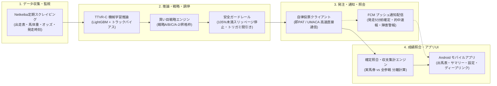
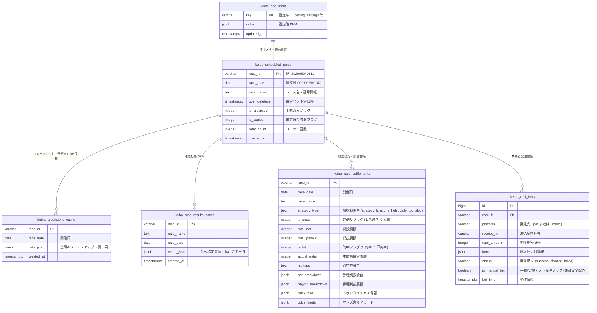

# 競馬AI予想・自律自動投票システム 要件定義書 (REQUIREMENTS SPECIFICATION)

本書は、競馬AI予想および完全自律型自動投票システム（即PAT / UMACAスマート対応）における機能要件、非機能要件、外部インターフェース、データモデル、および安全規定を網羅的に定義した要件定義書です。

---

## 1. システム概要・プロジェクト目的

### 1.1 システムの目的
本システムは、JRA（日本中央競馬会）全レースを対象とし、ゼロリーク特徴量に基づく機械学習アンサンブルモデル（TTVR-C）により、オッズとの歪み（バリュー・エッジ）を自律検出し、資金保護を最優先としたガードレール下で最適な買い目を自律発注（即PAT / UMACAスマート）するシステムです。

### 1.2 コア運用思想（資金保護最優先原則）
1. **銀行自動入金の完全禁止**:
   - 銀行口座からの自動チャージは一切行わず、ユーザーが事前に手動入金した「購入限度額（投票用残高）」の範囲内でのみ動作します。
2. **Fail-Closed 原則（物理遮断）**:
   - 外部通信（Netkeiba）、DB（Supabase）、JRA投票サイトのいずれかに不整合・エラーが発生した場合は、強行発注を一切行わず「見送り」へと安全退避します。
3. **二重発注絶対防止（Idempotency）**:
   - 発注確定POST送信後のタイムアウト発生時であってもリトライは行わず、資金の二重買い付け・二重引き落とし事故を根絶します。

---

## 2. 機能要件 (Functional Requirements)

### 2.1 レース情報・オッズ・馬体重自動収集機能
| 要件ID | 機能名 | 詳細仕様 |
| :--- | :--- | :--- |
| **FR-SCR-01** | レース日程・枠順自動取得 | 開催日の朝（06:00以降）、当日開催される全競馬場・全レースの枠順・騎手・斤量データをNetkeibaから自動取得しDBへ登録。 |
| **FR-SCR-02** | 馬体重・増減取得 | 発走60分前頃に公表される公式馬体重および増減データを自動スクレイピングし、特徴量へ反映。 |
| **FR-SCR-03** | リアルタイムオッズ取得 | 発走15分前および発走5分前の直前に、最新の単勝・複勝・馬連・馬単オッズを取得。 |
| **FR-SCR-04** | 最新確定発走時刻追従 | 発走15分前・5分前の直前に確定発走予定時刻を再取得。発走順延を検知した場合はタイマーを自動補正。**30分以上の遅延は自動投票中止（見送り）**。 |
| **FR-SCR-05** | 耐障害リトライ | Netkeiba通信エラー時は最大3回（1秒→2秒→4秒）バックオフ再試行。全滅時は当該ステージを安全スキップしFCM緊急通知。 |

### 2.2 AI予想・オッズ歪み検出機能
| 要件ID | 機能名 | 詳細仕様 |
| :--- | :--- | :--- |
| **FR-ML-01** | ゼロリーク特徴量生成 | 前日以前確定の過去走データのみを用いて時系列特徴量を構築（未来情報の混入を100%排除）。 |
| **FR-ML-02** | TTVR-C カスケード推論 | LightGBMによる馬券内確率推論とオッズ乖離エッジ検出モデルのカスケードにより、各馬の「確信度」「エッジ」「期待回収率」を算出。 |
| **FR-ML-03** | トラックバイアスリアルタイム補正 | 当日の前半レース結果から内外・脚質有利度を動的算出し、午後の推論スコアへ補正適用。 |

### 2.3 買い目戦略・調停・トリガミ防止機能
| 要件ID | 機能名 | 詳細仕様 |
| :--- | :--- | :--- |
| **FR-STR-01** | 戦略B（超勝負R） | 芝・ダート不問、高確信度・高エッジレース。投資計2,500円（単勝1,000円＋馬単◎→◯▲△ 3点各500円）。 |
| **FR-STR-02** | 戦略A（芝厳選ケリー傾斜） | 芝レース対象、エッジ比例ケリー傾斜。投資計1,000円（単勝700円＋複勝300円）。 |
| **FR-STR-03** | 戦略C（ダート手堅い本命防衛） | ダートレース対象、安定本命軸。投資計1,000円（単勝700円＋複勝300円）。 |
| **FR-STR-04** | 戦略A-2（芝波乱妙味） | 芝レース対象、中穴・妙味狙い。投資計1,000円（単勝500円＋複勝500円）。 |
| **FR-STR-05** | 自然合致優先の原則 | 朝8:30時点で午後に本来の戦略（A/C/A-2）に合致するレースが存在する場合、**午前の昇格枠は選定しない**。 |
| **FR-STR-06** | 0件時デイリー昇格枠 | 自然合致レースが当日0件の場合のみ、当日最高スコアの1レースを「本日厳選No.1」として実馬券に昇格。 |
| **FR-STR-07** | スリッページ防止ガード | 発走5分前の再オッズ取得時、**期待回収率が 105.0% 未満** に急落した場合は見送り退避。 |
| **FR-STR-08** | トリガミ検知＆券種間引き | 各券種の下限オッズで `単独的中払戻金 < 総投資額` となる目のみを除外（全券種不適格時はレース見送り）。 |
| **FR-STR-09** | 昇格枠自動再創出（リカバリ） | 発注失敗や除外で見送りとなり当日実馬券が0件になった場合、**後続レースから改めて1日1R昇格枠を再選定**。 |

### 2.4 自律型多段階スケジューラー
| 要件ID | 機能名 | 詳細仕様 |
| :--- | :--- | :--- |
| **FR-SCH-01** | 24時間常時自律監視 | 1分周期で当日全レースの発走時刻を監視し、該当タイミングで各ステージ処理を自動発火。 |
| **FR-SCH-02** | Stage 1 (前日・朝8:30) | 全レース初期事前予想、当日開催判定、自然合致有無の判定、初期昇格枠候補の選定。 |
| **FR-SCH-03** | Stage 2 (発走60分前) | 馬体重・増減スクレイピング、トラックバイアス反映、第2次予想更新。 |
| **FR-SCH-04** | Stage 3 (発走30分前) | オッズ変動検知、発走予定時刻の遅延チェック、第3次予想更新。 |
| **FR-SCH-05** | Stage 4 (発走15分前) | 直前オッズ取得、確信度・エッジ再計算、確定発走時刻照合。 |
| **FR-SCH-06** | Stage 5 (発走5分前) | **最終確定ステージ**。直前オッズ再推論、スリッページ・トリガミ検証、本命取消チェック、自動投票執行、FCM通知発信。 |

### 2.5 自動投票実行・通信機能 (IPAT / UMACA)
| 要件ID | 機能名 | 詳細仕様 |
| :--- | :--- | :--- |
| **FR-BET-01** | 即PAT 高速HTTP発注 | ガラケー版即PAT（`g.ipat.jra.go.jp`）のCGIと0.2〜0.5秒で直接通信し、通常投票を一括執行。 |
| **FR-BET-02** | UMACAスマート 高速HTTP発注 | UMACAスマート（`pw_740_i.cgi` 他）と直接通信。独自27文字ビットマスクコード生成により一括執行。 |
| **FR-BET-03** | 二重発注防止物理ロック | 投票確定POST送信後はタイムアウトでも再試行禁止。DB＋メモリフラグによる完全排他制御。 |
| **FR-BET-04** | 完全一致原則（全破棄） | 複数買い目のうち1点でもCGI投入エラー、出走取消、締切が発生した場合、確定せずに即時ログアウト・投票中止。 |
| **FR-BET-05** | 受付時間外即時スキップ | 「受付時間外」「メンテナンス中」検知時は1回で当日実馬券投票をスキップし、FCM通知。 |
| **FR-BET-06** | 残高オンデマンド照会 | 手動更新時および発走5分前の自動投票直前のみログインして最新残高をDB保存。 |
| **FR-BET-07** | マニュアル（手動・実機テスト）投票機能 | ユーザーが指定したレース・買い目（券種・馬番・金額）をシステム経由で即PAT/UMACAへ直接発注可能。 ★**【厳格な集計除外規定】**: 本機能による購入履歴は、AIモデルの収支集計（日次サマリー、累計サマリー、回収率計算）から**完全に除外（混入ゼロ）**する。残高不足時は発注不可とし、二重タップ防止ロックを完備。 |

### 2.6 確定成績・収支集計機能
| 要件ID | 機能名 | 詳細仕様 |
| :--- | :--- | :--- |
| **FR-SET-01** | レース結果自動照合 | レース終了約5〜15分後にNetkeibaから確定着順・払戻金を自動取得し、投票台帳と照合・的中判定。 |
| **FR-SET-02** | 全参戦（仮想含む）モード | 実馬券（勝負＋実戦）に加え、各会場トップ3推奨の仮想馬券（200円）の投資・払戻・損益を合算集計。 |
| **FR-SET-03** | 実馬券のみモード | 自然合致レースおよび昇格レースのみを集計対象とし、仮想馬券が混入しない完全独立集計。 |
| **FR-SET-04** | 見送り損益効果集計 | AIが見送りと判断したレースについて、もし仮想買い目（200円）を買っていた場合の払戻をシミュレートし、資金保全効果を分離計算。 |
| **FR-SET-05** | マニュアル投票の完全分離 | 手動・実機テスト投票（FR-BET-07）のレコード（`is_manual_bet=true`）は、AI収支計算クエリから物理的に除外。 |

### 2.7 Androidモバイルアプリケーション機能
| 要件ID | 機能名 | 詳細仕様 |
| :--- | :--- | :--- |
| **FR-APP-01** | レース一覧・詳細UI | 開催場・R番号の横スクロールタブ切り替え、出馬表、印（◎◯▲△☆穴消）、AI確信度、買い目推奨カード表示。 |
| **FR-APP-02** | 収支サマリー画面 | 「全参戦（仮想含む）」と「実馬券のみ」をトグル切り替え可能。投資額、払戻額、回収率、的中率、的中R一覧を表示。 |
| **FR-APP-03** | 設定画面・排他UIロック | 即PAT / UMACA モード切替、接続テスト（認証・残高確認）機能。モード切替・照会中はUIを排他ロック。 |
| **FR-APP-04** | FCMプッシュ通知・ディープリンク | 発走5分前確定通知タップ時、**該当レース（競馬場タブ・R番号）へ直接ジャンプして自動フォーカス展開**。 |
| **FR-APP-05** | SWRキャッシュ・0秒起動 | `LocalCacheManager` による暗号化Diskキャッシュで瞬時に前回データを表示し、バックグラウンドで最新同期。 |
| **FR-APP-06** | プルリフレッシュ完全同期 | 画面引っ張り更新時はDisk/メモリキャッシュを破棄して最新APIを再取得。アプリ復帰時（`onResume`）もスマート自動再検証。 |
| **FR-APP-07** | マニュアル実機テスト投票UI | 指定レースで任意の買い目を入力し、事前確認ダイアログ（対象・金額・残高明示）を経てシステム投票を実行する機能。 |

---

## 3. 非機能要件 (Non-Functional Requirements)

### 3.1 性能・レスポンス要件 (Performance)
1. **APIレスポンス速度**:
   - キャッシュヒット時のAPI応答時間は **100ms以内**。
   - レース直前（発走5分前）のモデル推論＋トラックバイアス計算は **200ms以内**。
2. **自動投票執行時間**:
   - 即PAT / UMACAスマートへのログインから投票確定完了までの所要時間は **0.5秒以内**（回線混雑時でも2.0秒以内）。
3. **モバイルUI描画速度**:
   - アプリ起動時のレース一覧表示はローカルキャッシュ活用により **0秒（100ms未満）** で描画。

### 3.2 可用性・信頼性 (Reliability & Availability)
1. **クラウド常時稼働**:
   - Render PaaS 上で 24時間365日 バックグラウンドスケジューラーが自律稼働（メモリ使用量 200MB 以下の省メモリ設計）。
2. **Fail-Closed 原則（資金保護の絶対優先）**:
   - スクレイピング障害、DB切断、オッズ異常値検知時は直ちに発注停止し、安全側に倒す。
3. **自己修復機能 (Data Healer)**:
   - ネットワーク一時切断等で着順照合が漏れたレースがある場合、毎時および開催終了後に自動バッチ（`heal_today_weights_and_results`）が欠落を検知して自己修復。

### 3.3 セキュリティ・資金安全性 (Security & Financial Safety)
1. **銀行口座自動入金の禁止**:
   - プログラムによる銀行自動振替・自動追加入金機能は一切持たず、手動入金された残高（購入限度額）内のみで購入。
2. **認証情報の安全管理**:
   - 即PAT加入者番号、暗証番号、PARS、UMACAカード番号、PIN、生年月日等の機密情報はソースコードに含めず、すべてクラウド環境変数（Render Environment Variables）にて暗号化管理。
3. **二重発注絶対防止（Idempotency Lock）**:
   - レースIDごとにメモリキャッシュおよびSupabase DB上の `keiba_real_bets` に発注記録を即座に永続化し、同日同一レースへの重複発注を物理的に遮断。
4. **AIエージェントによる実機・実資金テスト投票時の事前確認義務**:
   - 開発・保守・検証作業中、AIエージェントがスクリプト実行等により実際の資金引き落としを伴う実機投票を執行することは、**事前にユーザーへ対象（場・R・買い目・金額）を明示し承諾を得ない限り絶対に禁止**。検証時は `dry_run=True` を標準とし、実資金テストはユーザーの明示的許可後のみ執行可能とする。

### 3.4 保守性・拡張性 (Maintainability & Extensibility)
1. **Strategy Pattern による戦略ロジックの完全疎結合化 (`app/strategies/`)**:
   - 買い目生成・調停・トリガミ間引きロジックを独立モジュール化し、APIサーバーや投票通信に影響を与えずに新戦略の追加・パラメータ最適化・オフラインバックテスト（`experiments/`）との共通利用を可能にする。
2. **モデル配置の静的デプロイ方針**:
   - LightGBMモデルは本番サーバーでの動的自己更新を行わず、Git管理された検証済みモデルファイル（`.txt`）を手動デプロイして運用の確実性を担保。

---

## 4. 外部インターフェース仕様 (External Interfaces)

### 4.1 外部システム接続
| 接続先 | 通信プロトコル | 用途・通信内容 | 認証方式 |
| :--- | :--- | :--- | :--- |
| **Netkeiba** | HTTPS (GET) | 出走表、公式馬体重、リアルタイムオッズ、確定着順・払戻金、発走変更時刻の取得 | なし (公開Web) |
| **JRA 即PAT** | HTTPS (GET/POST) | `g.ipat.jra.go.jp` (ガラケー版CGI) によるログイン、残高照会、通常投票発注 | 加入者番号・暗証番号・PARS |
| **JRA UMACAスマート** | HTTPS (GET/POST) | `www.ipat.jra.go.jp/sp/umaca/` によるログイン、投票用残高照会、27文字コード投票 | カード番号・PIN・生年月日 |
| **Firebase (FCM)** | HTTPS (HTTP v1 API) | 発走前リマインド、本確定投票速報、的中・払戻通知、障害アラート配信 | Google サービスアカウント JSON |
| **Supabase** | HTTPS / WSS (PostgREST) | スケジュール、予想キャッシュ、実馬券台帳、システム設定の永続化 | Project URL & Anon/Service Key |

### 4.2 主要 Web API エンドポイント一覧 (FastAPI)
| メソッド | パス | 機能・概要 |
| :--- | :--- | :--- |
| `GET` | `/predict/today` | 当日開催全会場・全レース一覧および各レースの推奨馬・マーク・ステータスを取得 |
| `GET` | `/predict/race` | 指定レースIDの出走全馬AIスコア、詳細オッズ、トラックバイアス、推奨買い目カードを取得 |
| `GET` | `/summary/daily` | 指定日の日次収支サマリーを取得（`is_real_only=true` で実馬券のみ、`false` で全参戦） |
| `GET` | `/summary/aggregate` | 全期間累計収支サマリー、直近30日間サマリー、券種別成績統計を取得 |
| `GET` | `/settings/betting` | 現在の自動投票設定（モード: `ipat`/`umaca`、上限額、最新残高）を取得 |
| `POST` | `/settings/betting` | 自動投票設定の更新、および投票モード切替（即時残高照会をトリガー） |
| `POST` | `/admin/test-ipat` | 即PAT / UMACA の接続テスト（ログイン・残高照会検証）を実行 |
| `POST` | `/admin/heal` | 当日データの未反映馬体重・未確定着順を強制再スクレイピング・自己修復 |

---

## 5. データモデル要件 (Database Schema)

Supabase（PostgreSQL）上に構成される主要テーブルおよびその責務・保持方針：

### データ永続化・インデックス規定
1. **全件永続保存（DELETE 禁止）**:
   - 予想ログ（`keiba_predictions`）および実馬券ログ（`keiba_real_bets`）はバックテスト検証および生涯収支追跡の資産であるため、過去データの自動削除は行わず全件保持。
2. **インデックス設計**:
   - `keiba_scheduled_races`: `(race_date, venue_name, race_no)` 複合インデックス。
   - `keiba_predictions`: `(race_id, stage)` 複合インデックス、`is_real_bet_target` 単体インデックス。
   - `keiba_real_bets`: `(race_id)` ユニークインデックス（二重発注のDB層物理防御）。

---

## 6. 付録：用語集 (Glossary)

| 用語 | 定義・説明 |
| :--- | :--- |
| **即PAT (IPAT)** | JRA公式のインターネット投票サービス。本システムではガラケー版URL（`g.ipat.jra.go.jp`）の軽量CGI直接通信を利用。 |
| **UMACAスマート** | JRAのキャッシュレスICカード「UMACA」会員向けスマホ投票Web。27文字のビットマスク暗号化コードで直接発注。 |
| **TTVR-C** | 本システムで稼働するアンサンブル機械学習予測モデル（Two-Tier Value Ranking & Confidence Cascade）。 |
| **トラックバイアス** | 当日の芝・ダートのコース状態（内ラチ沿いが有利か、外差しが届くか）のリアルタイム偏り指標。 |
| **スリッページ** | 投票直前のオッズ急落現象。本システムでは期待回収率が105%未満に落ちた場合に見送り退避。 |
| **トリガミ** | 的中したにもかかわらず、配当金が購入総額を下回りマイナスになる現象。本システムでは事前に該当目を除外（間引き）。 |
| **Fail-Closed** | システム障害や通信断が発生した際、危険な動作（誤発注）を防ぐため、完全に遮断・安全停止する設計方針。 |
| **SWR (Stale-While-Revalidate)** | キャッシュされた既存データを即座に画面表示しつつ、バックグラウンドで最新データを非同期取得して差し替える通信設計。 |

