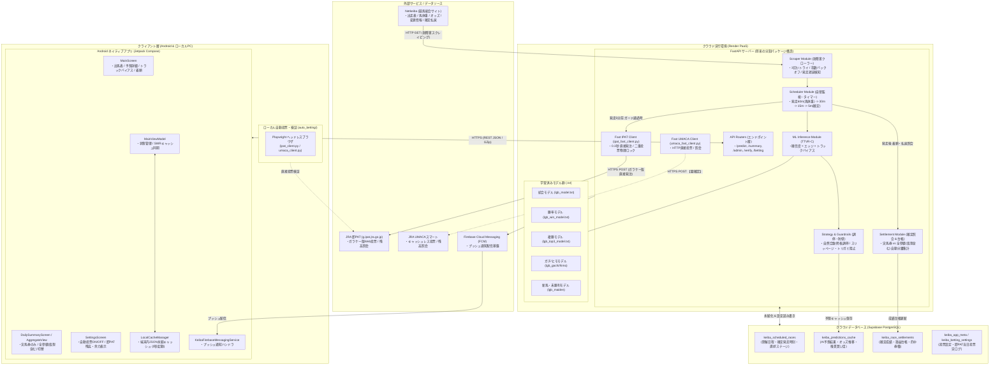
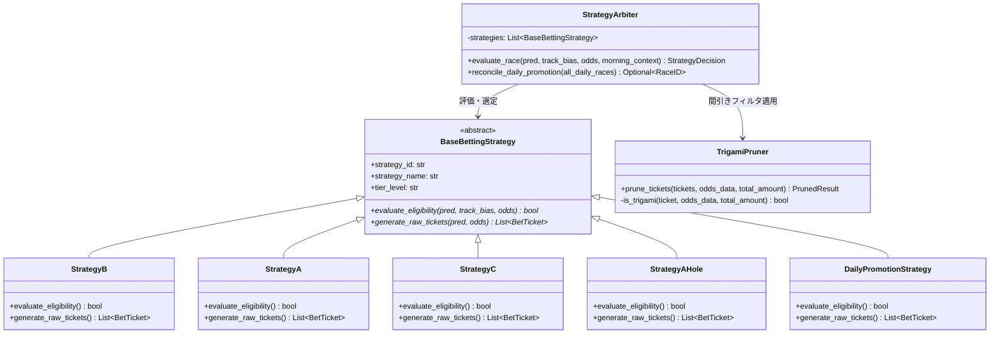

# システム詳細設計書・リバースエンジニアリング仕様書 (SYSTEM ARCHITECTURE)

本書は、競馬AI予想および自動投票（即PAT / UMACAスマート）システムの全体像、技術スタック、アーキテクチャ構成、自律スケジューラ、安全ガードレール、障害時レジリエンス、および将来のリファクタリング（モジュール物理分割）を見据えた詳細設計ドキュメントです。

---

## 1. システム全体概要・基本設計思想

本システムは、機械学習アンサンブルモデル（TTVR-C）によるオッズ歪み（バリュー・エッジ）検出に基づき、JRAの投票プラットフォーム（即PAT / UMACAスマート）へ完全自律で安全発注を行うシステムです。

### 基本原則 (Architecture Core Principles)
1. **資金保護最優先（Fail-Closed 原則）**:
   外部通信（Netkeiba）、DB接続（Supabase）、JRA認証のいずれかに異常や不整合を検知した場合、システムは安全停止（発注スキップ）を基本とし、サイレントな誤発注や資金流出を物理遮断します。
2. **ゼロリーク保証（Zero-Leakage Protocol）**:
   前日確定データのみを用いた時系列特徴量生成を徹底し、未来情報の混入（先読みバイアス）を100%排除します。
3. **即時描画とバックグラウンドサイレント同期（SWRキャッシュ駆動）**:
   Android端末側ではローカル暗号化キャッシュを活用して0秒描画を実現し、バックグラウンド通信で最新の馬体重・オッズ・確定着順をシームレスに同期します。
4. **モジュール疎結合化と段階的リファクタリング**:
   現在 `backend-render/main.py`（約8,500行）に集約されている機能を、責務ごとの独立パッケージに物理分割可能なアーキテクチャとして定義します。

---

## 2. 技術スタック一覧

| レイヤ / 領域 | 言語 / 実行基盤 | 主要フレームワーク・ライブラリ | 役割・用途 |
| :--- | :--- | :--- | :--- |
| **Backend API / Worker** | Python 3.10+ | **FastAPI**, **Uvicorn**, Pydantic | REST API サーバー、非同期リクエスト処理、GZip通信圧縮、定期メンテナンスタスク |
| **機械学習 (ML / AI)** | Python | **LightGBM** (`lgb_model.txt` 他多数), **Pandas**, **NumPy**, Scikit-learn, Optuna | 馬券内確率・勝率予測、ガチ/ヒモ分類、オッズ乖離（エッジ）算出 |
| **Webスクレイピング** | Python | **Requests**, **BeautifulSoup4**, **lxml** | Netkeiba（出走表、馬体重、リアルタイムオッズ、確定着順・払戻金、発走時刻変更） |
| **自動投票エンジン** | Python | **Requests** (Fast Client), **Playwright** (Chromium / ヘッドレス) | 即PAT（ガラケー版URL `g.ipat.jra.go.jp` 直接通信）、UMACAスマート自動投票 |
| **データベース / ストレージ** | PostgreSQL (DBaaS) | **Supabase** (`supabase-py`, PostgREST) | 開催日程スケジュール、予想キャッシュ、成績確定台帳、運用メタ情報永続化 |
| **プッシュ通知基盤** | クラウド通知 | **Firebase Admin SDK** (FCM), HTTP v1 API | レース発走前リマインド、オッズ急変、自動投票完了/エラー、残高不足通知 |
| **モバイルクライアント** | Kotlin 1.9+ / Android 8.0+ (API 26+) | **Jetpack Compose**, **Material 3**, Coroutines, StateFlow, ViewModel | レース出馬表・AI予想・トラックバイアス・確定収支サマリー・自動投票設定UI |
| **モバイル通信・キャッシュ** | Kotlin / Java | **Retrofit2**, **OkHttp3**, **Gson**, **LocalCacheManager** (内部ストレージ暗号化/JSON) | SWR（Stale-While-Revalidate）による0秒起動・バックグラウンドサイレント更新 |
| **インフラ・デプロイ環境** | クラウドPaaS / PC環境 | **Render** (Web Service, 常時24時間稼働), Google Drive, Windows PowerShell | `git push origin main` によるRender自動デプロイ、Google DriveへのAPK自動転送 |
| **研究・実験環境** | Python / Jupyter | Google Colab, Parquet, Jupyter Notebook | 2015〜2026年の時系列ゼロリーク検証、トラックバイアス実験、特徴量探索 |

---

## 3. システム構成図



---

## 4. コアロジック詳細設計方針（決定済み仕様）

### ① 外部通信・DB障害時のレジリエンス設計（Fail-Safe方針）
1. **Netkeibaアクセス障害時**:
   - 最大3回のリトライを実施（バックオフインターバル: 1秒 → 2秒 → 4秒）。
   - 3回連続で失敗した場合は、安全のため**当該ステージの推論および自動投票を即座にスキップ**。
   - FCMプッシュ通知経由で管理者のスマートフォンへ緊急警告アラート（`SCRAPER_ERROR`）を発信。
2. **Supabase DB接続ダウン時（Fail-Closed 原則）**:
   - DBから投票設定や二重発注フラグが読み取れない、または書き込めない場合、**一切の自動投票を停止（物理遮断）**。
   - メモリ内キャッシュのみによる強行発注は禁止し、資金保護を最優先とします。

### ② レース中止・出走取消・発走順延の緊急制御
1. **本命馬（◎）の直前除外・出走取消時**:
   - 発走5分前時点で◎馬が取消または競走除外となった場合、対抗（◯）馬への自動繰り上げは行わず、**「そのレースは完全見送り（投票中止）」**として処理。
2. **発走時刻の遅延（順延）への自動追従**:
   - 発走15分前（Stage 4）および発走5分前（Stage 5）の直前において、Netkeibaのレースヘッダーから**最新の確定発走予定時刻を再取得**。
   - 発走遅延が確認された場合、スケジューラーのタイマーを新時刻に合わせて自動補正・再スケジュールし、フライング発注を防止。
3. **発走遅延長期化時の安全タイムアウト**:
   - 当初の発走予定時刻から **30分以上の遅延** が発生した場合、馬場状態の急変や馬のイレ込みによる予測モデルの有効性低下を考慮し、安全のため**「そのレースは自動投票中止（見送り）」**とする。

### ③ 自動投票（即PAT）の最終ガードレール規則
1. **オッズ急落（スリッページ）の停止しきい値**:
   - 発走5分前の最終オッズによる再推論時、**期待回収率が 105.0% 未満** に急落した場合、アドバンテージ消失と判断して自動発注を見送り、ステータスを「見送り」へ退避。
2. **トリガミ判定条件 ＆ 券種間引きアクション（資金効率最大化）**:
   - **判定条件**: 「各券種の下限オッズで計算して、その券種の単独的中時払戻金が当該レースの総投資額を下回る場合」をトリガミ券種と認定。
   - **対処アクション（券種間引き）**: トリガミになる券種のみを発注リストから除外し、期待値の高い残りの券種のみを発注。
     - **戦略B（勝負R / 計2,500円）**: 単勝2.5倍未満、または馬単各点5.0倍未満のトリガミ目を間引き、高配当な目のみを発注。
     - **戦略A / 戦略C（単700円＋複300円 / 計1,000円）**: 複勝下限オッズが3.4倍未満の場合、**複勝300円を除外**し、単勝700円のみを発注。
     - **戦略A-2（単500円＋複500円 / 計1,000円）**: 複勝下限オッズが2.0倍未満の場合、**複勝500円を除外**し、単勝500円のみを発注。
     - **昇格枠（計1,000円）**: 同様に下限払戻金が1,000円未満の複勝を除外し、単勝のみを発注。
     - ※間引きの結果、全券種がトリガミまたは不適格となった場合は、レース全体を「見送り」として安全停止。
3. **自然合致レースと昇格枠の運用順序**:
   - **自然合致優先の原則**:
     - 朝8:30の事前予想で、午後に本来の発注基準（**戦略A**: 芝厳選エッジ比例ケリー傾斜、**戦略C**: ダート手堅い本命防衛、**戦略A-2**: 芝波乱妙味拾い上げ）を満たすレースが1件以上存在することが確定している場合、**昇格枠は選定しない（本来の高期待値レースのみに資金集中）**。
   - **0件時デイリー昇格枠**:
     - 当日全レースの中で本来の基準を満たす自然合致レースが0件の場合のみ、当日最高スコア（確信度 × エッジ × 適性度）の1レースを「本日厳選No.1」として実馬券に昇格。
   - **自然合致レースの追加参戦**:
     - 昇格枠の発注が完了した後であっても、後続レースに本来の基準を満たす自然合致レースが現れた場合は参戦を許可。
4. **1日の参戦上限（リミッター）**:
   - 即PATの手動入金残高（購入限度額）が尽きるまで、基準を満たす全レースに参戦（特定の固定レース数上限は設けず、事前入金残高枠の範囲内で自律運用）。

### ④ 収支集計エンジン（実馬券 vs 全参戦）
1. **全参戦（仮想含む）モード**:
   - 実馬券（勝負＋実戦）に加え、各会場トップ3推奨の仮想馬券（通常 仮想投資200円＝単勝100円＋複勝100円）の投資・払戻・損益・的中を合算。
2. **実馬券のみ（勝負＋実戦）モード**:
   - 自然合致レースおよび昇格レースのみを集計対象とし、仮想馬券が混入しない完全な独立性を維持。
3. **見送り損益効果（Pass Benefit）の分離計算**:
   - 全参戦モードでは、真の見送りレース（27レース等）のみを資金保全効果の集計対象とする。

### ⑤ 即PAT高速クライアント詳細設計（確定仕様）
1. **二重発注絶対防止・リトライ禁止 & フォールバック昇格枠の自動再創出**:
   - 確定POST（`kw_180.cgi`）送信後のタイムアウトや回線切断時は、二重買い付け・二重引き落とし事故を根絶するため**絶対にリトライを行わない（Fail-Closed 原則）**。
   - 発注不成立または結果不明となったレースは安全のため「見送り」へと格下げ退避。
   - 当該見送りにより当日の実馬券成立数が0件となった場合、**「その後の後続レースの中から、改めて当日最高スコアの1レースを1日1R昇格枠として再創出・選定」**し、当日の厳選1レース枠を自動的にリカバリ運用。
2. **買い目投入の部分失敗時のフェイルセーフ（完全一致原則・全破棄）**:
   - ポートフォリオの期待値バランスを保護するため、複数買い目（例: 単勝＋複勝、馬単複数点）のうち**1点でもCGI投入エラーが発生した場合は、確定ボタンを押さずにセッションを即時破棄（ログアウト）**し、投票全体を完全中止（見送り扱い）。
3. **JRAメンテナンス・受付時間外の検知と即時スキップ**:
   - ログイン時またはCGI応答時に「受付時間外」「メンテナンス中」等のエラーを検知した場合、無駄な再試行によるIPBANや負荷増大を防ぐため、**1回の検知で即座に当日実馬券投票をスキップ**。仮想馬券ログのみ記録し、FCMで管理者に即座に通知。
4. **購入限度額（残高）のオンデマンド＋発走直前照会**:
   - JRAサーバーへの過度な負荷を避けるため常時定期ポーリングは行わず、**「ユーザーがアプリで手動更新した時」** および **「発走5分前の自動投票直前」** にのみ即PATへログインして最新残高を取得・DB（`keiba_betting_settings`）に永続化。

### ⑥ UMACAスマート投票クライアント詳細設計（確定仕様）
1. **即PATと完全統一されたフェイルセーフ原則**:
   - 確定POST（`pw_742_i.cgi`）送信後のタイムアウト時はリトライ禁止（Fail-Closed）。未投票時は「見送り」へ退避し、フォールバック昇格枠の再創出ルールを適用。
   - 確認画面（`pw_741_i.cgi`）の `Nb` 配列検証により、出走取消（`3`/`A`）や締切（`2`）が1点でも検知された場合、または買い目投入エラー時は確定ボタンを押さずにセッション即時破棄（完全一致原則）。
   - UMACAスマートの受付時間外を検知した場合は1回で実馬券スキップし、FCM通知。
   - 残高照会はオンデマンド＋発走5分前照会。
2. **クライアント抽象化と共通ファクトリ設計**:
   - `BaseBettingClient`（抽象基底クラス）を介して `IPATFastClient` と `UMACAFastClient` のインターフェースを完全統一。
   - `BettingClientFactory.get_client(mode)` により、呼び出し元は動作モード（`"ipat"` / `"umaca"`）を意識せずポリモーフィックに発注・残高照会を実行可能。

### ⑦ Androidクライアント状態管理・プッシュ通知・キャッシュ整合性設計（確定仕様）
1. **FCMプッシュ通知タップ時のディープリンク直接遷移**:
   - バックエンドからのFCM通知ペイロード（`extra_race_id`）を受信し、通知タップ起動時に該当レースの**「開催競馬場タブ」および「該当レース番号（例: 東京11R）」へ自動フォーカス・即時展開**。ユーザーのタップ数を最小化。
2. **キャッシュ破棄（Cache Invalidation）とプルリフレッシュの完全同期**:
   - 画面引っ張り更新（プルリフレッシュ）実行時は、メモリキャッシュおよび `LocalCacheManager`（Diskキャッシュ）の対象日付データを**強制破棄し、最新APIからクリーンフェッチ**。
   - 発走時刻を過ぎたレースは「予想キャッシュ」のTTL（生存期間）を満了とし、バックエンドの「確定着順・払戻結果」を優先取得。
3. **アプリ復帰時（フォアグラウンド復帰時）のスマート自動再検証**:
   - `onResume` イベント検知時、直前に「発走5分前」を迎えたレースや「結果確定待ち」のレースが存在する場合、**バックグラウンドでサイレントに結果照会・サマリー差分同期を実行**し、手動リフレッシュ不要で最新状態を維持。
4. **即PAT / UMACA モード切替時の即時残高同期 ＆ 排他UIロック**:
   - 設定画面で投票モードを切り替えた際、バックエンドで即座に対象クライアントの `login()` を実行して最新残高を照会・DB同期。
   - **照会処理中はUIをローディング状態にし、連続タップや二重変更を防止（排他制御）**。照会完了後に最新残高をサマリー画面・設定画面へ反映。

### ⑧ 機械学習推論・数理モデル運用設計（確定仕様）
1. **モデル配置・デプロイライフサイクル（静的配置・手動デプロイ方針）**:
   - レース直前（発走5分前）の推論の絶対的な高速性（0.1秒台）とメモリ安定性を最優先。
   - 本番サーバー上でのオンライン再学習や自動自己更新は行わず、手動バックテスト・検証を経て確定した LightGBM モデルファイル（`.txt`）を Git リポジトリ経由で安全にデプロイ・バージョン管理。
2. **推論パイプライン（TTVR-C Cascade & ケリー配分）**:
   - 着順確率予測モデル（LightGBM Ranker）とオッズ乖離エッジ検出モデルのカスケード連携。
   - レース当日の内・外バイアス（トラックバイアス）補正値をリアルタイムに特徴量へ注入。
   - ポートフォリオの資金配分は「分数ケリー基準（Fractional Kelly）」を基底とし、期待値に応じた傾斜配分を適用。

### ⑨ データベース（Supabase）設計・データ永続化方針（確定仕様）
1. **データ永続保存の原則（DELETE 禁止）**:
   - 過去の予想データ（`keiba_predictions`）、実馬券発注履歴（`keiba_real_bets`）、スケジュール情報（`keiba_scheduled_races`）は、長期バックテストおよび収支統計分析の資産であるため**全件永続保存**（自動物理削除は実施しない）。
2. **インデックス最適化**:
   - 大量データ蓄積時も高速応答を維持するため、`race_id`、`race_date`、`is_real_bet_target`、`status` にB-treeインデックスを設定。
3. **レガシー資産（`auto_betting/`）の整理方針**:
   - ローカルPC向けPlaywright自動投票（`auto_betting/`）は、Render本番の `ipat_fast_client.py` / `umaca_fast_client.py` への完全移行に伴い、将来のリファクタリングフェーズでアーカイブまたは廃止整理とする。

### ⑩ マニュアル（手動・実機テスト）投票機能の設計（集計完全除外）
1. **目的・ユースケース**:
   - JRA投票導線（即PAT / UMACAスマート）が本番環境で正常に執行できるかを少額（100円等）で実機疎通検証するため、およびユーザーが任意レースで手動発注を行えるようにするための専用機能。
2. **AI収支集計からの完全物理除外**:
   - マニュアル発注レコードは `keiba_real_bets` に `is_manual_bet=true` フラグを付与して保存。
   - **日次収支サマリー、累計収支サマリー、回収率計算、的中率の集計クエリでは `WHERE is_manual_bet IS NOT TRUE`（または `is_manual_bet = false`）を厳格に適用し、AIモデルの公式パフォーマンスデータへの混入を100%遮断**。
3. **安全ガードレール**:
   - 手動発注時も「購入限度額（投票用残高）」の事前チェックを行い、残高不足時は発注を拒否。
   - 二重発注防止のための送信中UIロック、および発注前確認モーダル（場・R・式別・馬番・金額・残高の明示）を必須化。
4. **AIエージェント実機テスト執行時のユーザー事前承諾義務**:
   - 開発・デバッグ・検証プロセスにおいて、AIエージェントがプログラム実行等により直接リアル資金を消費する実機発注を行うことは、**事前にユーザーへ対象（場・R・式別・馬番・金額・理由）を明示し、明示的な許可・承諾を得ない限り絶対に禁止**。
   - 通常の疎通検証は `dry_run=True` を使用し、実投票の確認はユーザーの事前承諾を経てから執行する。

---

## 5. 将来のリファクタリング設計（`main.py` 物理分割パッケージ構造案）

現在 `backend-render/main.py` に集中しているロジックを、設計書・要件定義書の確定後に以下のパッケージ構造へと段階的に物理分割します。
特に**「買い目戦略（A/B/C/A-2）」「昇格調停」「トリガミ間引き」は頻繁な改良・置換・バックテストが想定されるため、独立したドメイン層（`app/strategies/`）として完全分離**します。

```
backend-render/
├── app/
│   ├── __init__.py
│   ├── main.py                     # FastAPI アプリ生成、ミドルウェア、ライフサイクル管理
│   ├── core/                       # 基盤共通モジュール
│   │   ├── config.py               # 環境変数、定数定義
│   │   ├── database.py             # Supabase クライアント・接続管理
│   │   ├── security.py             # 認証・IP制限
│   │   └── exceptions.py           # 共通例外クラス、Fail-Fastハンドラー
│   ├── scrapers/                   # スクレイピング層（耐障害リトライ実装）
│   │   ├── netkeiba_client.py      # 出走表、オッズ、馬体重、確定払戻クローラー
│   │   └── schedule_crawler.py     # 開催日程、発走変更情報検知
│   ├── ml/                         # 機械学習・推論エンジン層
│   │   ├── feature_builder.py      # ゼロリーク特徴量生成
│   │   ├── inference_engine.py     # LightGBMモデル推論 (TTVR-C Cascade)
│   │   └── track_bias.py           # トラックバイアス（内有利/外有利）計算
│   ├── strategies/                 # ★【高頻度変更・置換対象】買い目戦略・調停・トリガミ分離層
│   │   ├── __init__.py
│   │   ├── base.py                 # 戦略抽象基底クラス (BaseBettingStrategy)
│   │   ├── strategy_b.py           # 戦略B: 超勝負R 馬単レバレッジ (単勝+馬単3点)
│   │   ├── strategy_a.py           # 戦略A: 芝厳選 ケリー傾斜 (単勝+複勝)
│   │   ├── strategy_c.py           # 戦略C: ダート手堅い本命防衛 (単勝+複勝)
│   │   ├── strategy_a_hole.py      # 戦略A-2: 芝波乱妙味 (単勝+複勝)
│   │   ├── daily_promotion.py      # 0件時デイリー昇格調停 (本日厳選No.1選出)
│   │   ├── arbiter.py              # 自然合致優先・昇格調停オーケストレーター
│   │   ├── trigami_pruner.py       # トリガミ検知 ＆ 券種動的間引きエンジン
│   │   └── config.py               # 各戦略のしきい値・係数設定 (外部JSON/YAML連携可)
│   ├── betting/                    # 投票発注・通信・物理安全ガード層
│   │   ├── guardrails.py           # スリッページ(期待値105%未満)停止、残高余力チェック
│   │   ├── base_client.py          # 投票クライアント共通インターフェース (BaseBettingClient)
│   │   ├── factory.py              # クライアント生成ファクトリ (BettingClientFactory)
│   │   ├── ipat_fast_client.py     # 即PAT (g.ipat) 高速通信クライアント
│   │   └── umaca_fast_client.py    # UMACAスマート 高速通信クライアント
│   ├── settlement/                 # 成績確定・収支集計層
│   │   ├── settlement_engine.py    # 実馬券/仮想馬券 結果照合ロジック
│   │   ├── summary_calculator.py   # 日次・累計・券種別サマリー集計
│   │   └── healer.py               # データ自己修復・強制再照合バッチ
│   ├── scheduler/                  # 自律スケジューラー層
│   │   ├── maintenance_loop.py     # 24時間常時稼働メインループ
│   │   └── multi_stage_timer.py    # 発走60m/30m/15m/5m ステージ管理
│   └── routers/                    # Web API ルーター層
│       ├── predict.py              # 予想取得・一覧API
│       ├── summary.py              # 日次・総合サマリーAPI
│       ├── betting.py              # 自動投票設定・残高照会API
│       ├── verify.py               # 結果照合・検証API
│       └── admin.py                # 管理者用修復・ヘルスチェックAPI
├── models/                         # 学習済み LightGBM モデル群 (.txt)
└── static_data/                    # stats_dict.json, features.json
```

---

## 6. 買い目戦略・調停・トリガミガードの疎結合化アーキテクチャ設計

戦略ロジックをシステム本体（APIサーバー・投票通信・DB照合）から完全に切り離し、**「個々の戦略の追加・差し替え・パラメータ最適化をシステム停止や他機能への影響ゼロで実施できる構成（Strategy Pattern）」** を採用します。



### 疎結合化による4大メリット
1. **プラグイン式差し替えの容易性**:
   - 新たな戦略（例: `StrategyD` ダート馬連特化、`ModelB_ValueHunter` 等）を追加する際、`BaseBettingStrategy` を継承した新ファイルを追加してレジストリに登録するだけで完了。既存のスケジューラやAPIコードには1行も手を加える必要がありません。
2. **トリガミ間引きエンジンの共通モジュール化 (`trigami_pruner.py`)**:
   - 券種（単勝・複勝・馬連・馬単・三連複）に依存しない汎用ロジックとして独立。各戦略が生成した「粗の買い目」を受け取り、「下限オッズ時の払戻金 < 総投資額」となる目を自動的に間引いた「最終買い目」を出力します。
3. **オフラインバックテストとの100%同一コード共有**:
   - `experiments/` 配下のバックテストやシミュレーションスクリプトでも本番と同一の `strategies/` モジュールをそのままインポートして検証可能。検証環境と本番環境の「実装のズレ（ロジック不整合）」を根絶できます。
4. **しきい値・パラメータの外部設定化 (`config.py`)**:
   - 期待回収率下限（105%）、エッジしきい値、ケリー傾斜配分比率などをコード本体から分離し、設定ファイル（JSON/環境変数）の変更のみで即座に調整可能とします。
